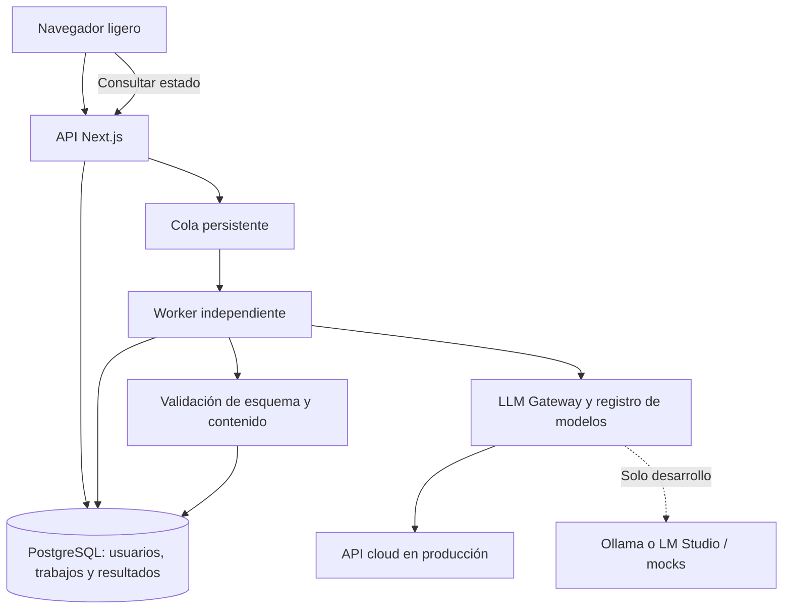

# Copilot Docente — Arquitectura y decisiones de diseño

Fecha: 2026-11-26. Revisión del documento: 0.2. Estado: documento de trabajo. Base funcional del software: `v0.1.0` (`ea09e8c`). Las propuestas de arquitectura no implican cambios implementados.

## Visión y alcance

Aplicación web para automatizar planeaciones y tareas docentes en México. El SaaS administrado es la hipótesis comercial inicial; BYOK y despliegues institucionales son alternativas por validar. El navegador debe funcionar en equipos básicos, sin instalar software adicional. Inferencia exclusivamente cloud en producción. Los modelos locales y las API de prueba son herramientas de desarrollo; no son características del producto. El modelo comercial, segmento exacto, precios y proveedor de producción quedan por validar.

## Base técnica

- Fork de trabajo: https://github.com/cristian357r4/copilot_docente.
- Repositorio original (upstream): https://github.com/licmanuelperalta-hue/copilot_docente.
- Base funcional: `v0.1.0`, commit `ea09e8c`, PR #1 integrado a `main`.
- Stack existente: Next.js 13.4.10, React 18.2, JavaScript, API Routes, Axios y SDK OpenAI; dependencias sujetas a auditoría.
- Validado manualmente: `npm run build`, `npm start`, consulta al catálogo NVIDIA, inferencia aislada y generación de una planeación de cinco sesiones (caso TC-AI-001, ejecución TST-005 en [test-plan.md](testing/test-plan.md)) con `nvidia/nemotron-3.5-lightning-30b-a3b`.
- Cambios integrados: lockfile, limpieza de credenciales en archivos actuales, eliminación de código duplicado del frontend, modelo NVIDIA configurable, inicialización diferida de OpenAI, timeout, manejo de errores sin registrar objetos completos y eliminación del fallback silencioso.
- Pendiente: prueba funcional OpenAI, diagnóstico del ENOTFOUND intermitente (las pruebas posteriores funcionaron), validación de esquema, calidad pedagógica y auditoría de dependencias. Las claves heredadas pueden permanecer en el historial; solo su propietario puede revocarlas. La clave personal compartida debe rotarse si aún no se ha hecho.
- No se ha implementado persistencia, cola durable, evaluación sistemática, agentes ni exportación documental. Conservar inicialmente el stack, previa revisión de seguridad y compatibilidad.
- No considerar esta base una versión comercial ni desplegarla públicamente sin controles adecuados.

## Método de decisiones

Problema → requisito → alternativas existentes → PoC reproducible → decisión y consecuencias (ADR). No convertir una idea de implementación en requisito. Revisar costo, complejidad, madurez, seguridad, compatibilidad y experiencia de usuario.

## Arquitectura objetivo propuesta

La cola y la aplicación pueden compartir PostgreSQL. El registro del trabajo y su encolado deben ser atómicos o usar transactional outbox. No mantener una transacción abierta durante una llamada de inferencia. No asumir que un proceso de Next.js seguirá ejecutándose tras devolver HTTP 202.

## Registro de decisiones

| ADR | Estado | Decisión / hipótesis |
|---|---|---|
| 001 | Acordado | Producción exclusivamente cloud; cliente sin instalaciones adicionales. |
| 002 | Acordado como requisito | Separar lógica de negocio de proveedores/modelos; mecanismo concreto por validar. |
| 003 | Acordado | Mocks, modelos locales y APIs experimentales para desarrollo. |
| 004 | Requisito acordado, diseño propuesto | Trabajos durables independientes del navegador; API y worker separados. |
| 005 | Requisito acordado, diseño propuesto | Evitar duplicados involuntarios. Evaluar clave idempotente persistida y restricción única; hash opcional, no obligatorio. |
| 006 | Requisito acordado, diseño propuesto | Recuperar trabajos y resultados tras cerrar, recargar o desconectar el navegador. Polling inicial; SSE si aporta valor. |
| 007 | Requisito acordado, diseño propuesto | Telemetría de costos, tokens, latencia y errores por intento y modelo. |
| 008 | Propuesto | PostgreSQL y pg-boss como primera PoC; comparar Graphile Worker y BullMQ antes de fijar dependencia. |
| 009 | Propuesto | Workflows deterministas antes de agentes autónomos; evaluar Temporal si la complejidad crece. |
| 010 | Pendiente | Selección de proveedor y modelos comerciales tras benchmark de calidad y costos. |
| 011 | Acordado | Catálogo curricular estructurado y versionado, limitado a quinto de primaria; sin RAG, embeddings ni base vectorial en el MVP. Los derechos de reutilización permanecen pendientes. |
| 012 | Propuesto | Separar políticas de facturación de la lógica de negocio. |
| 013 | Propuesto | Evaluar credenciales de inferencia propias, del docente o de una institución (BYOK). |
| 014 | En investigación | SaaS administrado frente a despliegue institucional y self-hosted. |
| 015 | Propuesto | Presupuestos, cuotas, reserva y liquidación de consumo sin duplicar cargos internos. |

## Alcance curricular acordado, implementación pendiente

[ADR-011](adr/0011-curriculum-knowledge.md) limita el MVP a quinto de primaria
en México mediante un catálogo estructurado y versionado, con relaciones
explícitas entre grado, campo formativo, contenido y PDA. Cubre Lenguajes;
Saberes y Pensamiento Científico; Ética, Naturaleza y Sociedades; y De lo Humano
y lo Comunitario. Excluye contenidos y PDA exclusivos de sexto. Cada referencia
debe conservar fuente oficial, edición y página, junto con la versión del
catálogo. El almacenamiento físico no se decide aquí.

RAG, embeddings y bases vectoriales quedan fuera del MVP. La construcción y
validación del catálogo, la revisión docente y los derechos de reutilización
siguen pendientes; la línea base no acredita esas capacidades. RF-009 permanece
Propuesto. Los criterios se detallan en TST-016 a TST-023 del
[plan de pruebas](testing/test-plan.md), sin resultados de ejecución nuevos.
Resolver las condiciones de reutilización antes de distribuir contenido
protegido en un producto comercial.

## Trabajos e idempotencia

- `POST /api/jobs` registra un trabajo durable y devuelve su identificador y estado; `GET /api/jobs/:id` y un listado de trabajos propios permiten recuperar el resultado. HTTP 202 si sigue pendiente; devolver el trabajo existente cuando se repite la misma intención.
- Generar un identificador aleatorio de intención antes de enviar el POST y conservarlo localmente hasta recibir confirmación. El servidor lo vincula al usuario autenticado y a la operación, con una restricción única. Comparar payload normalizado al reutilizarlo; 409 ante conflicto. La comparación puede hacerse sin hash; SHA-256 es opcional para optimización o auditoría.
- Una clave nueva con los mismos parámetros puede significar una nueva generación deliberada. Si existe un trabajo activo equivalente, mostrarlo y pedir confirmación explícita antes de duplicar. No usar un hash global como identidad del trabajo ni deduplicar entre usuarios.
- El cierre de la página no cancela. El backend es fuente de verdad. La cancelación es explícita y no garantiza evitar un cargo ya iniciado.
- Estados propuestos: QUEUED, PROCESSING, VALIDATING, COMPLETED, FAILED, CANCELLED; OUTCOME_UNKNOWN cuando no se sabe si el proveedor completó una llamada. Reintentos solo bajo política explícita y con límites.
- Persistir resultados, versiones de prompt/modelo, intentos y, cuando existan, identificadores remotos. No almacenar credenciales ni datos sensibles en logs.
- La entrega durable no garantiza una sola facturación por proveedor. Si hay timeout tras iniciar una petición externa, reconciliar mediante identificador remoto cuando sea posible; no reintentar ciegamente. Contabilizar reintentos y cargos inciertos.

## Comparación inicial

| Opción | Ventaja | Desventaja / verificación pendiente |
|---|---|---|
| pg-boss | PostgreSQL, transacciones, workers Node.js, pocos servicios | Compatibilidad con Node/Next y recuperación real de fallos |
| Graphile Worker | PostgreSQL, SQL add_job, at-least-once | Semántica de job_key al estar activo; gestionar resultados aparte |
| BullMQ | Deduplicación, flows, workers, Redis o PostgreSQL desde v6 | Evaluar madurez del backend PostgreSQL y necesidad de funciones avanzadas |
| Temporal | Durable execution, workflows complejos y actividades | Mayor complejidad para MVP; efectos externos siguen necesitando idempotencia |
| API background del proveedor | Consulta de trabajo remoto y reconciliación cuando existe | Dependencia del proveedor y condiciones de retención/privacidad |

Recomendación provisional: PoC con pg-boss + PostgreSQL, worker Node independiente y polling. Si falla compatibilidad o integración atómica, comparar Graphile Worker y BullMQ. Mantener el contrato de trabajos propio, independiente de la cola. No seleccionar aún proveedor definitivo de IA.

## Evaluación y costos de modelos

LLM Gateway con adaptadores o SDK existente (Vercel AI SDK como candidato), catálogo de modelos permitidos por entorno, salida normalizada, validación JSON y métricas. Desarrollo: mock, Ollama/LM Studio, NIM de prueba y APIs pagadas para benchmark. Producción: solo proveedores cloud autorizados. El usuario no necesita elegir proveedor. Evaluar con casos de planeaciones reproducibles, revisión docente, validez curricular, JSON, latencia, costo por planeación aceptada y tasa de reintento. Promptfoo es candidato para automatizar pruebas. No confundir calidad de un modelo local con calidad del candidato a producción.

## Modalidades comerciales (hipótesis)

| Modalidad | Alojamiento | Pago de inferencia | Consideraciones |
|---|---|---|---|
| SaaS administrado | Operador del producto | Operador, recuperado mediante suscripción o créditos | Menor fricción docente; controlar consumo y soporte |
| SaaS BYOK | Operador del producto | Cliente, directamente al proveedor | Reduce exposición a costos de IA; aumenta fricción y gestión de secretos |
| Despliegue institucional administrado | Infraestructura contratada por la institución | Institución | Ingresos por implementación y mantenimiento; mayor complejidad operativa |
| Community self-hosted | Usuario técnico | Usuario | Alternativa futura, no requisito del MVP ni instalación en el equipo del docente |

No se ha elegido modalidad comercial, proveedor cloud, Azure ni precios. Evaluar disposición a pagar, soporte, licencias, protección de datos, costos y experiencia de usuario antes de decidir. No introducir sistemas de pago ni BYOK por anticipado. En producción, la inferencia sigue siendo remota: self-hosted institucional significa alojamiento de la aplicación, no ejecución del modelo en la computadora del maestro. En un piloto evitar datos identificables de menores. Si se implementan créditos, vincular reservas y liquidaciones al trabajo y al intento, con idempotencia y política de errores explícita; distinguir consumo facturado por terceros de cargos al usuario.

## Próximos incrementos y criterios de aceptación

1. Base funcional NVIDIA versionada (completado en `v0.1.0`). Mantener pendientes de seguridad, OpenAI, DNS y calidad documentados; verificar rotación de claves personales.
2. Extraer gateway y configurar mock/model registry; validar esquema y métricas.
3. PoC PostgreSQL + cola + worker: doble clic, POST sin respuesta y reenvío con la misma clave, peticiones concurrentes, parámetros distintos con la misma clave, desconexión, reapertura, reinicio de worker, timeout incierto, autorización entre usuarios y generación nueva intencional. Ejecutar primero con mock contable.
4. Piloto de planeación editable, exportación Word mediante plantillas y evaluación con docentes. Las afirmaciones de alineación curricular quedan condicionadas a la validación del catálogo del incremento 5; no inferirla de la generación básica.
5. Construir y validar un catálogo curricular verificable de SEP, estructurado y versionado, exclusivamente para quinto de primaria; conservar fuente, edición y página, y comprobar sus referencias con docentes. El MVP no incorpora RAG, embeddings ni base vectorial. Reconsiderarlos solo ante una necesidad demostrada. Incorporar persistencia del contexto, automatizaciones y agentes solo cuando aporten valor medible. Piloto comercial y validación de costos.

## Referencias técnicas

- Stripe, idempotencia: https://docs.stripe.com/api/idempotent_requests
- pg-boss: https://pgboss.io/introduction y https://pgboss.io/api/adapters
- Graphile Worker: https://worker.graphile.org/docs/job-key
- BullMQ: https://docs.bullmq.io/guide/jobs/deduplication y https://docs.bullmq.io/guide/postgresql
- Temporal: https://docs.temporal.io/durable-execution y https://docs.temporal.io/activity-definition
- OpenAI Background Mode: https://developers.openai.com/api/docs/guides/background

## Pendientes y límites

No se ejecutó ningún benchmark de las colas ni una prueba de carga. No se verificaron la versión de Node ni las condiciones comerciales de los proveedores candidatos. La base funcional se verificó mediante capturas de las pruebas y del historial Git; no se auditó nuevamente el código final completo ni se ejecutaron pruebas de carga. Este documento no modifica el repositorio. El documento distingue requisitos acordados de soluciones provisionales.

## Desarrollo remoto

GitHub es la fuente de verdad. Trabajar mediante ramas cortas y PR hacia el fork, mantener `upstream` para consultar el original, usar `npm ci` en CI y entornos reproducibles, revisar diffs y pruebas antes del merge. Documentar instrucciones persistentes en `AGENTS.md`; crear issues con alcance y criterios de aceptación. Codex Cloud es candidato para tareas sin hardware local; las pruebas Ollama/GPU quedan en la estación personal. Configurar secretos fuera de Git y usar mocks para pruebas automatizadas, sin exigir credenciales reales. No utilizar equipos o cuentas corporativas para este proyecto personal sin autorización.
